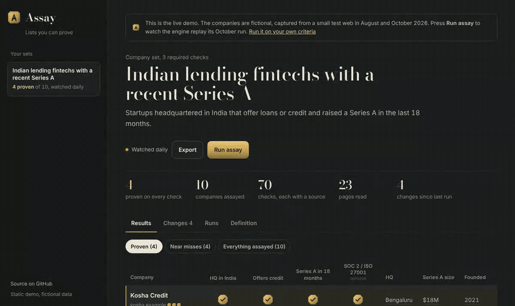
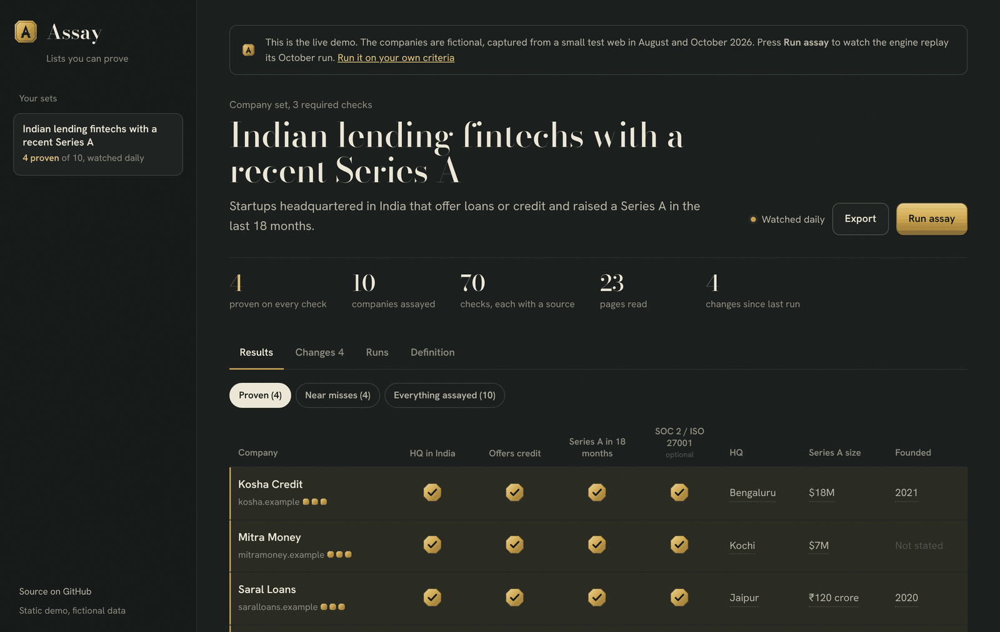
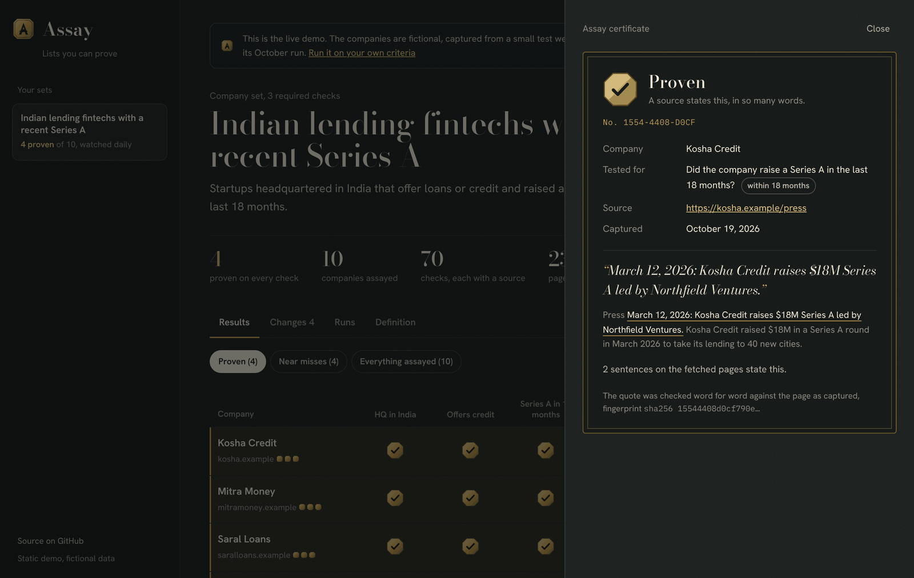
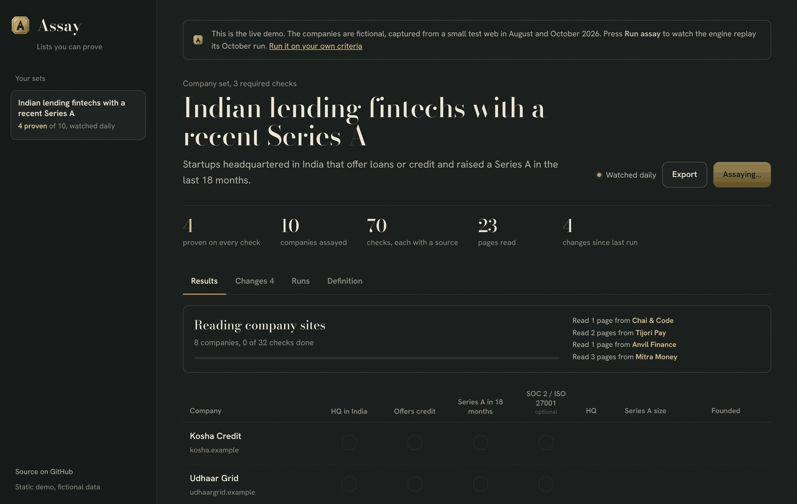
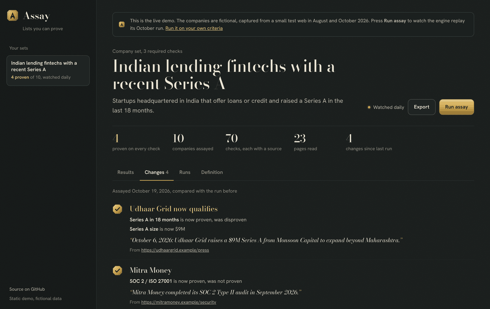
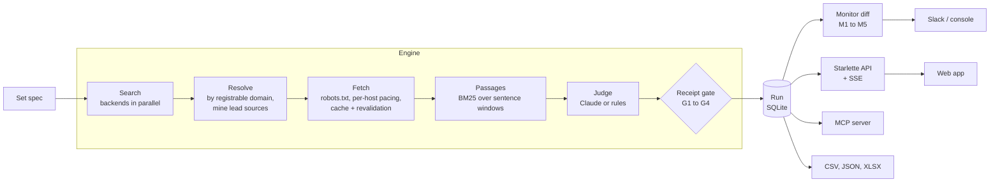

<div align="center">


# Assay

**Lists you can prove.**

Describe the companies you want in plain criteria. Assay searches the web, reads the sites, and checks every criterion against the source.<br>
A check counts only if its quote appears word for word on the page it cites. Then it watches the list and tells you what changed.

[**Try the live demo**](https://keshava3112.github.io/Assay/) &nbsp;&nbsp; [Quickstart](#quickstart) &nbsp;&nbsp; [How the proof works](#the-receipt-gate) &nbsp;&nbsp; [Architecture](#architecture)

[](https://github.com/keshava3112/Assay/actions/workflows/ci.yml)




</div>

## Why Assay

AI list builders are fast and confident, and you can't tell which cells they made up. A sales team finds out when a "Series A in the last 18 months" lead turns out to be a seed company from 2022. A VC analyst finds out in a partner meeting.

Assay treats every cell as a claim that needs a receipt:

- **Every proven or disproven check carries a verbatim quote, the URL, the capture date and a SHA-256 fingerprint of the page.** Click any mark to see its certificate.
- **If the model can't produce a quote that is really on the page, the check is downgraded to "not proven".** It isn't hidden; "we couldn't prove it" is useful too.
- **Lists are watched.** Re-runs are compared with the last one and you're told only what changed (a new match, a lost match, a criterion that flipped), each change with its own quote.
- **It's yours.** Self-hosted, MIT licensed, bring your own search API and model. It runs fully offline on the bundled demo with no keys at all.

## The live demo

The [demo](https://keshava3112.github.io/Assay/) is the real app over real engine output: GitHub Actions runs Assay twice over a small fictional web (August and October 2026) and publishes the result. Press **Run assay** to watch the October run replay event by event.

| Results, every check stamped | The certificate behind a check |
|---|---|
|  |  |
| **The engine at work** | **What changed since the last run** |
|  |  |

What the October run found, and why:

| Company | Result | Because the source says |
|---|---|---|
| Udhaar Grid | **New match** | "October 6, 2026: Udhaar Grid raises a $9M Series A…" |
| Mitra Money | SOC 2 now proven | "Mitra Money completed its SOC 2 Type II audit in September 2026." |
| Paisaloom | Disproven | Its Series A is dated 23 months ago; the window is 18. Search never returned Paisaloom; Assay found it through a link in a publisher's article |
| Ledgerline | Disproven | "headquartered in Singapore" |
| Tijori Pay, Gullak | Disproven | "does not offer loans" |
| Anvil Finance | Not proven | Mentions a Series A but never says when |

## Quickstart

```bash
pip install git+https://github.com/keshava3112/Assay
ASSAY_OFFLINE=1 assay demo        # two runs over the demo web, then opens http://127.0.0.1:8800
```

On the real web, write a set:

```yaml
# lending.yaml
id: india-lending-series-a
name: Indian lending fintechs with a recent Series A
query: Indian fintech startups offering loans or credit lines, Series A funding
backends: [exa]            # or brave, searxng; several are merged and deduplicated
lead_sources: [inc42.com]  # publishers: mined for the companies they link to
monitor: {every: 1d}
criteria:
  - id: india
    label: HQ in India
    question: Is the company headquartered in India?
  - id: series_a
    label: Series A in 18 months
    question: Did the company raise a Series A in the last 18 months?
    within_months: 18
  - id: security
    label: SOC 2 / ISO 27001
    question: Does the company hold SOC 2 or ISO 27001 certification?
    required: false
enrich:
  - {id: raised, label: Series A size, question: How much did the company raise in its Series A?}
```

```bash
export EXA_API_KEY=…  ANTHROPIC_API_KEY=…
assay add lending.yaml
assay run india-lending-series-a          # prints the stamped table
assay serve                               # the app, with live runs
assay watch india-lending-series-a --notify   # re-run on schedule, alert on changes
assay export india-lending-series-a --xlsx leads.xlsx
```

| Variable | What it does |
|---|---|
| `EXA_API_KEY`, `BRAVE_API_KEY`, `SEARXNG_URL` | Search backends |
| `ANTHROPIC_API_KEY` | Judges with Claude. Without it (or with `ASSAY_OFFLINE=1`) the rule judge runs on each criterion's `signals` and `against` regexes |
| `ASSAY_MODEL` | Model for the Claude judge (default `claude-sonnet-5-5`) |
| `SLACK_WEBHOOK_URL` | Change alerts go to Slack instead of the console |
| `ASSAY_TOKEN` | Bearer token required by the API |
| `ASSAY_DB` | SQLite path (default `.assay/assay.db`) |

## The receipt gate

The gate (`assay/gate.py`) is the only thing that decides whether a verdict counts. Judges, human or model, only propose.

| Rule | A proven or disproven check must… |
|---|---|
| **G1** | carry at least one piece of evidence |
| **G2** | quote text that appears verbatim on a page that was actually fetched (case, whitespace and quote style aside; at least 12 characters) |
| **G3** | cite the same version of the page: its content hash must match what was fetched |
| **G4** | for enriched values, contain the value inside its own quote |

Anything that fails is downgraded to *not proven* with the reason recorded and counted in the run's stats. The Claude judge is forced into a tool call that returns a passage id and a quote, so the gate can check it mechanically. A test feeds the engine a judge that invents quotes and asserts nothing gets through.

## Architecture



Ports and adapters. The domain (`domain.py`, `gate.py`, `monitor.py`) is pure and imports no I/O. Search, fetching, judging, notifying and the clock are `Protocol` ports (`ports.py`), so tests swap in a fictional web, a fake model client and a frozen clock.

- **Engine** (`engine.py`): an async pipeline with separate bounded semaphores for fetching and judging, a page and judge-call `Budget`, and one-hop discovery of about, press and security pages. It emits an event at every stage; the UI's live view and the static demo replay are both built from that stream.
- **Fetcher** (`adapters/fetch.py`): honours robots.txt, serialises requests per host with a minimum interval, retries 429 and 5xx with backoff, and accepts HTML only up to 2 MB. Pages go into a content-addressed disk cache with atomic writes; stale entries are revalidated with `If-None-Match` and `If-Modified-Since`.
- **Monitor** (`monitor.py`): M1 new and lost matches, M2 verdict flips, M3 field changes, M4 new rows are announced only if they match, M5 runs of a different question (a changed spec fingerprint) are never compared.
- **Store** (`store.py`): SQLite in WAL mode. Runs are JSON documents, and events go in an append-only table so a late SSE subscriber gets the full history and then the live tail.
- **API** (`api.py`): Starlette. A run starts in the background (`202`), a second run of the same set is refused (`409`), and `/api/runs/{id}/events` streams server-sent events.
- **Static site** (`site.py`): `assay site` bakes runs and their event streams into the same front end. That's how the demo runs on GitHub Pages with no server.

## Use it from an agent

```bash
pip install "assay-lists[mcp] @ git+https://github.com/keshava3112/Assay"
assay mcp
```

Tools: `list_sets`, `matches(set_id)` (rows with their quotes) and `changes(set_id)`. An agent can answer "which of these are new this week, and how do you know?" with the receipts attached.

## Development

```bash
pip install -e ".[dev]" && pytest -q
python scripts/build_demo_corpus.py     # regenerate the fictional demo web
```

There are 44 tests, covering the gate rules, both judges (Claude through a fake client), the engine on both snapshots, lead-source mining, monitor diffs, the fetcher against `httpx.MockTransport` (robots, cache, 304s, retries, offline fallback), store round trips, the API including SSE and 409s, exports, and the static build. CI runs them on Python 3.11, 3.12 and 3.13. See [CONTRIBUTING.md](CONTRIBUTING.md).

## Roadmap

- People and job-post entities next to companies
- A spec editor in the app
- More backends (Tavily, Kagi) and judges (OpenAI, Ollama)
- Email and webhook alerts
- Postgres store for teams

## Licence

MIT. The demo's companies, people, investors and publishers are fictional, and their sites use the reserved `.example` domain.
